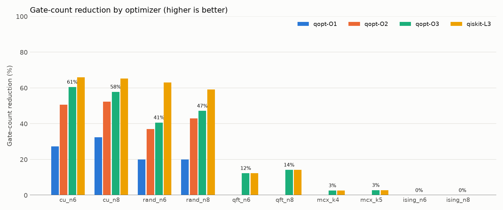

# QOPT: a peephole optimizer for quantum circuits

`qopt` is a small quantum-circuit compiler pass pipeline written from scratch in Python. It takes a circuit, rewrites it into an equivalent circuit with fewer gates, and **proves every result is correct** by comparing unitaries. A reproducible benchmark measures it against Qiskit's transpiler.



## Why

Every gate on real quantum hardware adds error, and two-qubit gates and T gates are especially expensive (T gates dominate the cost of fault-tolerant, error-corrected computation). Compilers therefore spend a lot of effort removing redundant gates. This project implements the core peephole techniques used in production compilers, on a deliberately small IR so each step is easy to reason about.

## How it works

```
circuit ──► IR (list of gates) ──► PassManager ──► optimized IR ──► verify (unitary equivalence)
                                       │
                          runs passes to a fixed point
```

**IR** (`qopt/ir.py`): a circuit is an ordered list of `Gate(name, qubits, params)` over `h x y z s sdg t tdg rx ry rz cx cz swap`. It includes the metrics used throughout: gate count, two-qubit count, depth (critical path) and T-count.

**Peephole engine** (`qopt/passes.py`): streams gates in program order and keeps, for each qubit, a stack of the live gates on that wire. For each incoming gate it walks back along its wires looking for a partner:

| Rewrite | Example |
|---|---|
| **Cancel** inverse pairs | `H·H → I`, `S·S† → I`, `CX·CX → I`, `CZ(a,b)·CZ(b,a) → I` |
| **Merge** same-axis rotations | `RZ(a)·RZ(b) → RZ(a+b)`, `T·T → S`, `X·RX(θ) → RX(θ+π)`, drops rotations equal to the identity |
| **Commute** past gates | `T(q0)·CX(q0,q1)·T†(q0) → CX`, `X(q1)·CX(q0,q1)·X(q1) → CX` |

Deleting a gate pops it from the wire stacks, so cancellations cascade in one pass (`H X T T† X H → ∅`).

**Commutation rule.** Two gates commute if, on every qubit they share, both act *diagonally in the same basis*: Z-basis (phase gates, CZ, the control of CX) or X-basis (X/RX, the target of CX). This is sound but deliberately incomplete. It only ever misses optimizations and never produces a wrong circuit. All rewrites hold up to a global phase, which is physically unobservable.

**Pass manager** (`qopt/manager.py`): runs a pipeline repeatedly until a fixed point. The three presets make an ablation study:

- `O1`: cancel adjacent inverses
- `O2`: O1 + merge adjacent rotations
- `O3`: cancel + merge, looking through commuting gates

**Verification** (`qopt/sim.py`): a dense unitary simulator (tensor contraction, up to ~10 qubits) checks `U_out = e^{iφ} U_in`. The test suite also cross-checks against Qiskit's `Operator` as an independent oracle.

## Results

10 seeded circuits from 5 families, run by `python benchmarks/run.py`. Every output, ours and Qiskit's, was verified equivalent to its input. Full tables (two-qubit count, T-count, depth, runtime) are in [`benchmarks/results/results.md`](benchmarks/results/results.md) and the raw data is in [`results.csv`](benchmarks/results/results.csv).

| circuit | original | qopt-O1 | qopt-O2 | qopt-O3 | qiskit-L3 |
|---|---:|---:|---:|---:|---:|
| compute-uncompute, 6q | 241 | 175 | 119 | **95** | 82 |
| compute-uncompute, 8q | 401 | 271 | 191 | **169** | 133 |
| random Clifford+T, 6q | 300 | 240 | 189 | **178** | 112 |
| random Clifford+T, 8q | 500 | 400 | 285 | **264** | 202 |
| QFT, 8q | 148 | 148 | 148 | **127** | 127 |
| multi-controlled X (V-chain), 9q | 105 | 105 | 105 | **102** | 102 |
| Trotterized Ising, 8q | 290 | 290 | 290 | **290** | 290 |

**What the numbers say**

- Each technique adds measurable value. On the compute-uncompute and random circuits, merging adds 17–23 percentage points over cancellation alone, and commutation adds another 4–10. On QFT and MCX, commutation is the only thing that helps at all.
- On QFT and multi-controlled-X, O3 **matches Qiskit's highest level** on gate count, runs in under 1 ms against Qiskit's ~6–11 ms, with about 200 lines of optimizer logic.
- On `cu_n8`, O3 removes more **two-qubit gates** than Qiskit at any level (45 → 37 against 39).
- Qiskit wins on random circuits. Its main advantage is *single-qubit resynthesis*: it collapses any run like `H·S·H·T` into at most three rotations, which pure peephole rewriting cannot do. That is the gap to close next (see below).
- Neither optimizer improves the Ising circuit. Its redundancy is only visible after reasoning about CNOT+RZ blocks as a whole, which calls for phase-polynomial methods.

## Usage

```bash
pip install -e ".[dev]"
pytest -q                       # 487 tests, including randomized equivalence checks
python benchmarks/run.py        # regenerates benchmarks/results/
python -m qopt examples/toffoli_pair.qasm --level 3 -o optimized.qasm
```

```python
from qopt import Circuit, optimize, equivalent

c = Circuit(2).add("t", 0).add("cx", 0, 1).add("tdg", 0).add("h", 1).add("h", 1)
out = optimize(c, level=3)      # -> just the CX
assert equivalent(c, out)
```

## Testing

- **Unit tests** for every rewrite rule, including the negative cases (e.g. `Z` must *not* commute through a CX target).
- **Randomized equivalence tests**: 450 random circuits with injected redundancy across all three levels. Each output must be unitarily equivalent to its input and never larger.
- **Guard tests**: idempotence, monotonicity across levels, and a check that the equivalence checker actually rejects a wrong circuit.
- **CI** (GitHub Actions) runs the tests on Python 3.10 and 3.12, then runs the full benchmark, which fails if any optimized circuit is not equivalent.

## Next steps

1. **Single-qubit resynthesis**: multiply out each maximal run of 1-qubit gates and re-emit it as ≤ 3 rotations (ZYZ Euler decomposition). This is the main gap versus Qiskit.
2. **Phase folding / rotation merging over CNOT+RZ regions** (Nam et al., 2018) to optimize the T-count of Toffoli-heavy and Trotter circuits.
3. **DAG-based IR** instead of wire stacks, to support template matching.
4. **Rust port** of the peephole engine, with Python bindings via PyO3.

## Layout

```
qopt/            ir.py, passes.py, manager.py, sim.py, generators.py, qiskit_bridge.py, __main__.py
tests/           unit + randomized equivalence tests
benchmarks/      run.py and results/ (csv, markdown tables, chart)
examples/        sample OpenQASM input
```
